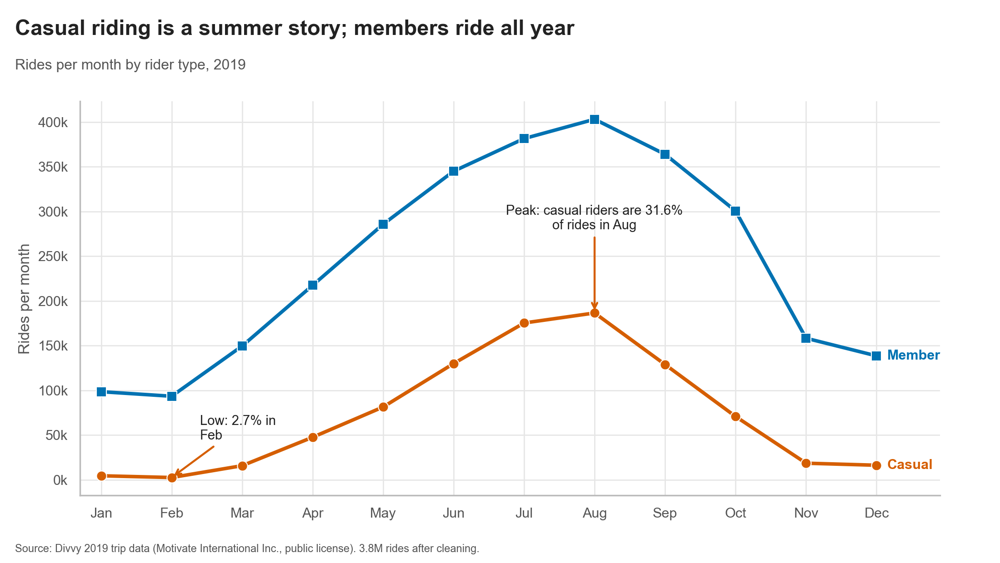
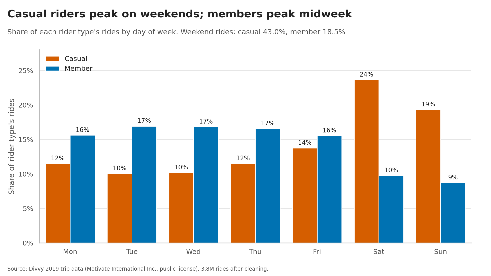
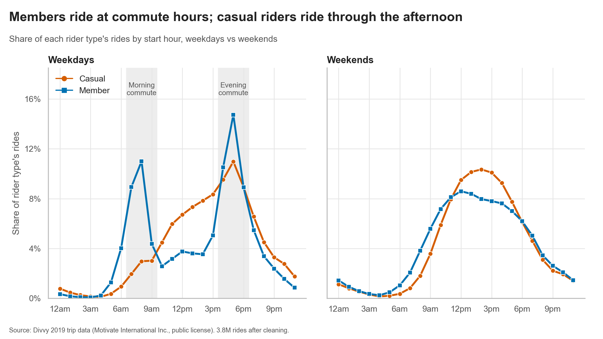
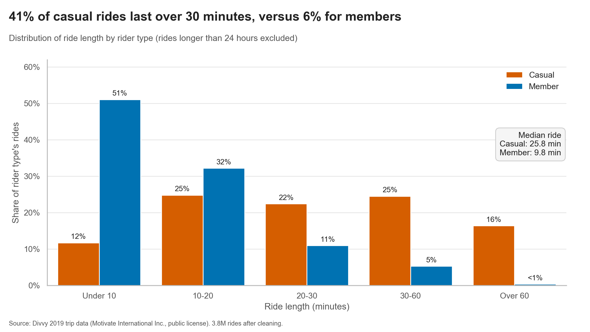
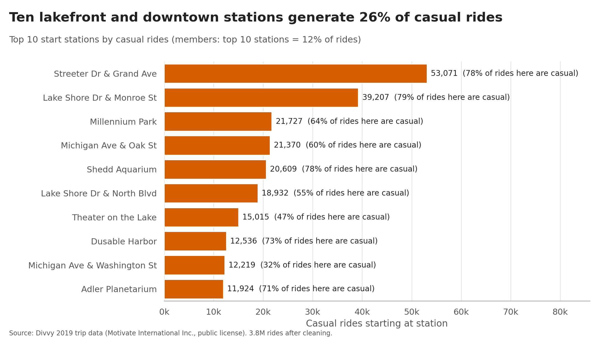

# Cyclistic Bike-Share Case Study: Converting Casual Riders into Annual Members

A full-cycle data analytics capstone using **3.8 million Divvy bike-share trips from 2019**. The project follows the Google Data Analytics workflow — **Ask → Prepare → Process → Analyze → Share → Act** — using Python, pandas, Seaborn and Tableau.

> **Business question:** How do annual members and casual riders use Cyclistic bikes differently, and what should the marketing team do to encourage casual riders to become annual members?
>
> **Main finding:** Casual riders tend to take longer, more seasonal and weekend-oriented trips, while annual members show more consistent year-round usage and stronger weekday commuting patterns.

## Project links

| Resource | Link |
|---|---|
| **Interactive Tableau dashboard** | [View Cyclistic Bike-Share Dashboard](https://public.tableau.com/views/CyclisticDashboard_17933357172270/Dashboard1?:language=en-US&:sid=&:redirect=auth&:display_count=n&:origin=viz_share_link) |
| **Kaggle notebook** | [View Python Capstone Notebook](https://www.kaggle.com/code/hazaimihamdani/cyclistic-bike-share-how-do-casual-riders-and-mem) |
| **LinkedIn** | [Connect with Hazaimi Hamdani](https://www.linkedin.com/in/hazaimi-hamdani-745aa6279) |

**Project deliverables:** Python analysis notebook and scripts, five Seaborn visualizations, cleaning log, Tableau dashboard, slide deck and executive summary. See the [repository structure](#repository-structure) for the expected project files.

---

## Contents

1. [Project objectives](#project-objectives)
2. [Key findings](#key-findings)
3. [Business recommendations](#business-recommendations)
4. [Data source and ROCCC assessment](#data-source-and-roccc-assessment)
5. [Data cleaning](#data-cleaning)
6. [Limitations](#limitations)
7. [Methodology](#methodology)
8. [Tableau dashboard](#tableau-dashboard)
9. [Repository structure](#repository-structure)
10. [How to reproduce the analysis](#how-to-reproduce-the-analysis)
11. [Data license, privacy and attribution](#data-license-privacy-and-attribution)
12. [Skills demonstrated](#skills-demonstrated)

---

## Project objectives

The objective is to analyze historical bike-share trip data to identify differences between casual riders and annual members. The analysis focuses on four practical questions:

- **When** do casual riders and members use the bikes — by month, weekday and hour?
- **How long** are their trips, and how do ride-duration patterns differ?
- **Where** do casual riders most often start their trips?
- **What actions** could Cyclistic test to encourage casual riders to consider annual membership?

The project is descriptive. It identifies usage patterns and develops recommendations for testing; it does not establish that a particular marketing intervention will cause membership conversion.

---

## Key findings

| Usage pattern | Casual riders | Annual members |
|---|---:|---:|
| Share of all rides | 23.0% | 77.0% |
| Rides from June to September | 70.6% | 50.9% |
| Rides on weekends | 43.0% | 18.5% |
| Rides in weekday commute windows (07:00–09:00, 16:00–18:00) | 21.3% | 47.6% |
| Median ride length | 25.8 min | 9.8 min |
| Rides longer than 30 minutes | 40.9% | 5.7% |
| Round trips (same start and end station) | 11.9% | 1.6% |
| Rides starting at the top 10 casual stations | 25.8% | 11.6% |

### Visual exploration

**1. Monthly seasonality**



**2. Weekday patterns**



**3. Hourly riding patterns**



**4. Ride duration**



**5. Top casual starting stations**



### Additional observations

- Casual riders show an evening peak around 17:00 on weekdays but no comparable morning peak.
- Average ride length (39.4 minutes for casual riders versus 12.9 minutes for members) is more affected by very long rides; the median provides a more representative comparison of a typical ride.
- Casual riders account for 2.7% of rides in February, while members record approximately 93,500 rides that month.

---

## Business recommendations

The analysis suggests three marketing opportunities. These are **hypotheses for controlled pilots**, not proven causal effects. The trip data does not contain membership conversion outcomes.

| # | Recommendation | Supporting evidence | Suggested success metric |
|---|---|---|---|
| 1 | **Time the offer:** test membership upgrade campaigns in April and May, before casual riding reaches its seasonal peak. | 70.6% of casual rides occur from June to September; casual share rises from 18% in April to 31.6% in August. | Casual-to-member conversion within 60 days, compared with a no-offer control group. |
| 2 | **Place the offer:** test sign-up QR codes and geo-targeted campaigns at high-volume casual starting stations, beginning with Streeter Dr & Grand Ave and Lake Shore Dr & Monroe St. | The top 10 stations account for approximately 26% of casual rides; about 78–79% of rides at the top two stations are casual. | Sign-ups per 1,000 casual rides compared with matched stations. |
| 3 | **Tailor the message:** test year-round commuting benefits with repeat weekday casual riders whose trip patterns resemble member usage. | 118,580 casual rides (13.5%) meet the project’s heuristic member-like definition: weekday commute window, 30 minutes or less, and point-to-point. | Conversion rate and winter retention among newly acquired members. |

Recommendation 3 uses a heuristic segment, not verified individual customer behaviour. See [Limitations](#limitations).

---

## Data source and ROCCC assessment

**Source:** Divvy (Chicago) 2019 trip data, supplied in four quarterly files (`Divvy_Trips_2019_Q1` to `Q4`) by Motivate International Inc. under the Divvy Data License Agreement. These records are used as a proxy dataset for the fictional Cyclistic case study.

The original source data contains **3,818,004 ride records and 12 source fields**. After cleaning, **3,816,067 rides were retained (99.95%)**. The Tableau-ready extract contains 14 columns, including prepared analytical fields used in the dashboard.

| ROCCC criterion | Assessment | Evidence | Caveat |
|---|---|---|---|
| **Reliable** | Pass | System-generated trip logs; no duplicate ride IDs, no unparsable timestamps and no nulls in core fields. 99.95% of records retained after documented cleaning. | Anomalies were identified and handled, including end-before-start rides, test/warehouse stations, rides over 24 hours and implausible birth years. |
| **Original** | Pass (proxy) | First-party operator records rather than a third-party aggregate. | Divvy data represents Divvy riders; Cyclistic is fictional. Findings should not be presented as actual Cyclistic customer behaviour. |
| **Comprehensive** | Partial | Full calendar year and 3.8 million rides, with fields covering time, stations and user type. | No pricing, rider ID, pass-type breakdown, bike type, coordinates or residency. The data describes usage patterns but does not explain why a casual rider would purchase a membership or quantify the convertible market. |
| **Current** | Partial | Covers a complete 12-month period. | The data is from 2019 and is pre-pandemic. Validate patterns against more recent data before making current business decisions. |
| **Cited** | Pass | The provider, source and license are identified in this README and project materials. Raw trip files are not included in this repository. | Review the license terms before redistributing any ride-level data. |

---

## Data cleaning

Cleaning steps were applied sequentially. See [`cleaning_log.csv`](cleaning_log.csv) for the recorded log.

| Cleaning step | Rows affected | Action |
|---|---:|---|
| Duplicate ride IDs | 0 | No duplicates found. |
| Rides under 60 seconds | 0 | No records met this exclusion rule. |
| End time before start time | 13 | Dropped. |
| Test and warehouse stations | 172 | Dropped. |
| Rides over 24 hours | 1,752 | Dropped. |
| Implausible birth years | 1,042 | Birth-year value blanked; ride retained. |
| Station names standardized | 70,714 | 24 station IDs mapped to one standardized station name. |

**Cleaning result:** 3,816,067 of 3,818,004 rides retained (99.95%).

---

## Limitations

1. **Rides, not riders.** Trip records are anonymized. The analysis cannot determine how often an individual rides or whether multiple casual trips belong to the same person.
2. **Visitors and locals cannot be separated.** Casual riders include day-pass users. Landmark-heavy starting stations may include visitors, but the available fields cannot identify residency or quantify the share of visitors.
3. **One historical year.** The dataset covers 2019 only. It cannot show year-over-year changes, and pre-pandemic patterns may differ from current behaviour.
4. **Descriptive, not causal.** The data contains no membership conversion outcomes. The recommendations require controlled tests before their effectiveness can be assessed.
5. **The “member-like casual” segment is heuristic.** The definition uses weekday commute windows (07:00–09:00 and 16:00–18:00), ride duration of 30 minutes or less, and point-to-point trips. It is a behavioural proxy, not a confirmed customer segment.
6. **Some case-study questions cannot be tested.** The source data has no bike type or coordinates, so the case-study claims about assistive bikes and commute share cannot be fully tested, and a station map requires a separate station-coordinate source.
7. **Case narrative and data differ.** The case study describes 5,824 bikes and 692 stations; the 2019 data contains 6,017 distinct bikes and 617 stations. Figures in this analysis are calculated from the supplied 2019 data.
8. **Cleaning affects averages more than medians.** Excluding rides over 24 hours removed approximately 0.05% of records. Medians are included to reduce the influence of unusually long rides. Timestamps are treated as Chicago local time.

---

## Methodology

The project follows the six phases of the Google Data Analytics workflow.

| Phase | Work completed | Main script or output |
|---|---|---|
| **1. Ask** | Defined the business task, stakeholders and analysis questions. | — |
| **2. Prepare** | Harmonized Q2's different column names and comma-formatted durations; combined four quarterly files; audited data quality; completed a ROCCC assessment. | `src/phase2_prepare.py` |
| **3. Process** | Standardized names to the case-study convention; applied and logged cleaning rules; engineered analytical features; ran validation assertions. | `src/phase3_process.py` |
| **4. Analyze** | Calculated baseline statistics and examined seasonality, when riders travel, ride duration and starting locations; exported summary tables. | `src/phase4_analyze.py` |
| **5. Share** | Created five accessible Seaborn charts, a Tableau-ready extract and an interactive Tableau dashboard. | `src/phase5_visualize.py`, `src/phase5_tableau_export.py` |
| **6. Act** | Developed three evidence-based recommendations with proposed pilots and success metrics; prepared the slide deck and executive summary. | `docs/` |

---

## Tableau dashboard

Explore the interactive dashboard, which allows users to compare casual riders and annual members through monthly, weekday, hourly, ride-duration and starting-station views.

**[Open the interactive Cyclistic Tableau dashboard](https://public.tableau.com/views/CyclisticDashboard_17933357172270/Dashboard1?:language=en-US&:sid=&:redirect=auth&:display_count=n&:origin=viz_share_link)**

Dashboard features include:

- Metric switch between ride counts and rider-type share.
- Adjustable long-ride threshold.
- Top-N starting-station control.
- Click-to-filter interactions for month, weekday, hour and station.
- Rider-type highlighting on hover.
- Show/hide methodology and limitations panel.

**Dashboard source attribution:** Divvy 2019 trip data, Motivate International Inc. (Divvy Data License Agreement). Cyclistic is a fictional company.

> **Publishing and data-use note:** Tableau Public includes the workbook's data extract and may make the underlying data downloadable. Review the Divvy Data License Agreement before publishing or redistributing ride-level data. If the license does not permit sharing the detailed extract, use an appropriately aggregated extract instead.

---

## Repository structure

```text
cyclistic-bike-share-case-study/
├── README.md
├── requirements.txt
├── .gitignore
├── src/                          # Run scripts in order from the repository root
│   ├── phase2_prepare.py
│   ├── phase3_process.py
│   ├── phase4_analyze.py
│   ├── phase5_visualize.py
│   └── phase5_tableau_export.py
├── data/raw/                     # Local input folder; raw Divvy files are not committed
├── charts/                       # Five PNG charts and alt_text.md
├── summary/                      # Generated summary tables (CSV)
├── cleaning_log.csv
└── docs/
    ├── Cyclistic_Casual_vs_Member_Findings.pptx
    ├── executive_summary.pdf
    └── tableau_build_guide.pdf
```

The Kaggle notebook is also available online: [Cyclistic Bike-Share Case Study on Kaggle](https://www.kaggle.com/code/hazaimihamdani/cyclistic-bike-share-how-do-casual-riders-and-mem).

---

## How to reproduce the analysis

### Requirements

The project README records the following tested library versions:

```text
pandas==3.0.2
numpy==2.4.4
matplotlib==3.10.8
seaborn==0.13.2
pyarrow  # Optional: used for Parquet output
```

Install the dependencies from the repository root:

```bash
pip install -r requirements.txt
```

### Steps

1. Download the four 2019 quarterly files from the [Divvy system data page](https://divvybikes.com/system-data) and place them in `data/raw/`. Review the [Divvy Data License Agreement](https://www.divvybikes.com/data-license-agreement) first.
2. In `src/phase2_prepare.py`, set `DATA_DIR = Path("data/raw")` if required by your local setup.
3. Run each script **from the repository root**, in this order:

```bash
python src/phase2_prepare.py        # Combine and audit -> trips_2019_raw.pkl
python src/phase3_process.py        # Clean and engineer features -> trips_2019_clean.pkl, cleaning_log.csv
python src/phase4_analyze.py        # Analyze -> summary/*.csv
python src/phase5_visualize.py      # Create charts -> charts/*.png, charts/alt_text.md
python src/phase5_tableau_export.py # Create Tableau extract -> tableau_rides.csv (approximately 430 MB)
```

Large intermediate files (`*.pkl`, `*.parquet`) and the Tableau-ready extract (`tableau_rides.csv`) are generated locally and should not be committed to GitHub. GitHub blocks individual files larger than 100 MB; regenerate these files by running the pipeline instead.

### Suggested `.gitignore`

```gitignore
data/
*.pkl
*.parquet
tableau_rides.csv
```

---

## Data license, privacy and attribution

- **Source:** Divvy trip data, provided by Motivate International Inc. under the [Divvy Data License Agreement](https://www.divvybikes.com/data-license-agreement). See also the [Divvy system data page](https://divvybikes.com/system-data).
- **Dashboard attribution:** Divvy 2019 trip data, Motivate International Inc. (Divvy Data License Agreement). Cyclistic is a fictional company.
- **Privacy:** The published trip records are anonymized and include trip times, stations, user type and, where provided, member gender and birth year. No attempt was made to identify individuals.
- **Raw data:** Raw trip files are not included in this repository.
- **Project context:** Cyclistic is a fictional company created for the Google Data Analytics Certificate case study. This independent project is not affiliated with Divvy, Lyft, Motivate International Inc. or Google.

---

## Skills demonstrated

- Data cleaning and schema harmonization with pandas.
- Reproducible Python analysis workflows.
- Exploratory and descriptive data analysis.
- Data-quality auditing and ROCCC assessment.
- Data visualization with Seaborn, Matplotlib and Tableau.
- Interactive dashboard design, calculated fields and parameter-driven analysis.
- Stakeholder-focused analytical storytelling.
- Evidence-based recommendations, test hypotheses and success metrics.

---

## Author

**Hazaimi Hamdani**

- **LinkedIn:** [linkedin.com/in/hazaimi-hamdani-745aa6279](https://www.linkedin.com/in/hazaimi-hamdani-745aa6279)
- **Kaggle:** [Cyclistic Bike-Share Case Study](https://www.kaggle.com/code/hazaimihamdani/cyclistic-bike-share-how-do-casual-riders-and-mem)
- **Tableau Public:** [Cyclistic Bike-Share Dashboard](https://public.tableau.com/views/CyclisticDashboard_17933357172270/Dashboard1?:language=en-US&:sid=&:redirect=auth&:display_count=n&:origin=viz_share_link)
